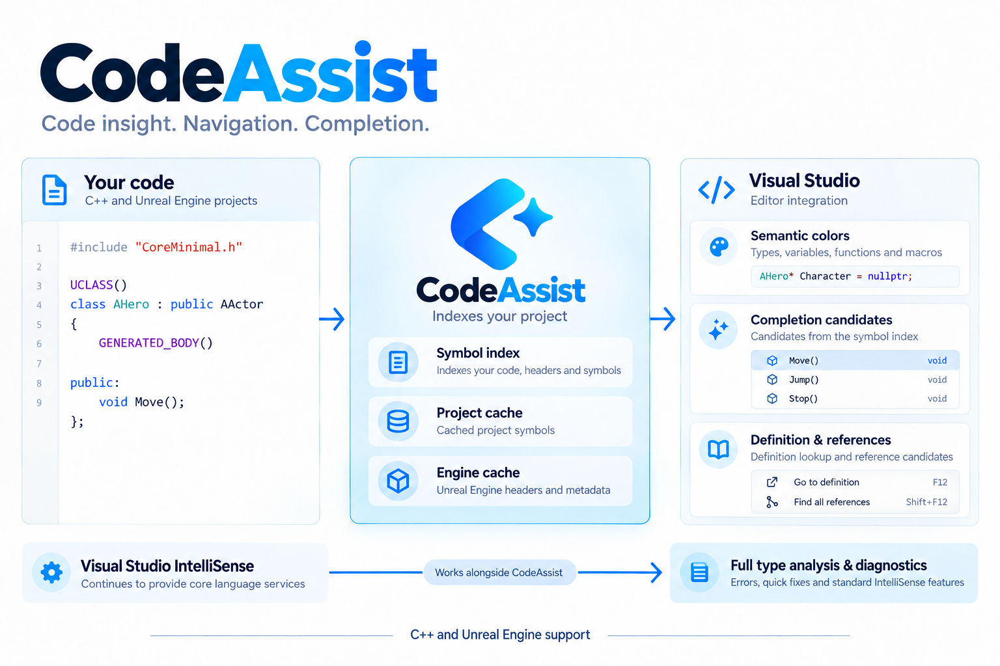

<p align="center">
  
</p>
<h1 align="center">CodeAssist</h1>
<p align="center"><strong>코드를 읽고, 심볼을 찾고, 다음 코드를 완성하세요.</strong></p>
<p align="center">
  <a href="docs/index.html">사용 안내</a> &middot;
  <a href="docs/feature-details.md">상세 기능</a> &middot;
  <a href="docs/keyboard-shortcuts.html">단축키</a> &middot;
  <a href="#설치">설치</a> &middot;
  <a href="LICENSE">MIT License</a>
</p>

---

Visual Studio용 오픈소스 개발 보조 확장입니다. C/C++ 코드의 자동완성, 의미 색상, 파일·심볼 검색과 정의·참조 탐색을 제공하며 Unreal Engine 프로젝트도 지원합니다.

<p align="center">
  
</p>

*작동 구조를 설명한 도식이며 실제 Visual Studio 화면은 아닙니다.*

## 주요 기능

- **코드 읽기** — 타입·변수·함수 의미 색상과 심볼 정보 표시
- **탐색** — 파일·심볼·메서드 검색, 정의·참조 찾기, 헤더·소스 전환
- **편집** — 자동완성 후보, 코드 조각과 선택 영역 편집
- **Unreal Engine** — 리플렉션 매크로·지정자와 include 후보 지원

Visual Studio IntelliSense와 함께 작동합니다. 기능별 동작 범위와 제한은 [상세 기능](docs/feature-details.md)을 참고해 주세요.

## 설치

| Visual Studio | 패키지 | 아키텍처 |
| --- | --- | --- |
| 2019 (16.x) | `CodeAssist.VS2019.vsix` | x86 |
| 2022 (17.x) · 2026 (18.x) | `CodeAssist.vsix` | x64 |

설치 파일은 빌드 후 `installers/<매니페스트 버전>/`에 생성됩니다. 현재 저장소에는 해당 경로의 설치 파일이 등록되어 있지 않으므로 아래 개발 안내에 따라 빌드해 주세요.

1. Visual Studio를 종료합니다.
2. 버전에 맞는 VSIX를 실행해 설치합니다.
3. Visual Studio를 다시 실행하고 프로젝트를 엽니다.

설치 대상에 포함된 버전과 실제 실행 검증 범위는 다릅니다. VS2019·2026의 실제 설치·실행은 미검증이며 ARM64는 설치 대상에 포함하지 않습니다.

## 개발

Visual Studio 2022, Visual Studio 확장 개발·C++ 데스크톱 개발 워크로드 및 .NET 8 SDK가 필요합니다.

`CodeAssist.sln`을 열고 `CodeAssist.Extension`을 시작 프로젝트로 설정한 뒤 `F5`로 실험용 Visual Studio를 실행합니다. Release 패키지는 `installers/<매니페스트 버전>/`에 보관합니다.

코어 테스트:

```powershell
dotnet test CodeAssist.Core.Tests/CodeAssist.Core.Tests.csproj
```

## 문서

- [사용 안내](docs/index.html) — 설치 후 사용법과 설정
- [기능·제한](docs/feature-details.md) — 구현 범위와 동작 설명
- [검증 기록](docs/validation/index.html) — 실행 결과와 검증 근거
- [Visual Assist 분석](docs/reverse-engineering/va-2630/index.html) — 원본 분석과 미확인 사항

HTML 문서는 저장소를 내려받은 뒤 브라우저에서 열어 주세요. Visual Assist와의 전체 동등성은 검증되지 않았습니다.

---

[MIT License](LICENSE) · Microsoft 또는 Epic Games와 제휴하거나 공식 승인을 받은 제품이 아닙니다.
