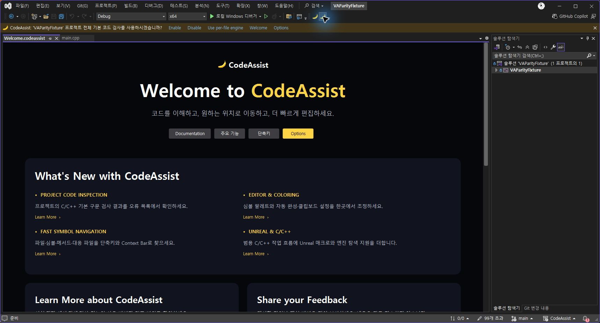
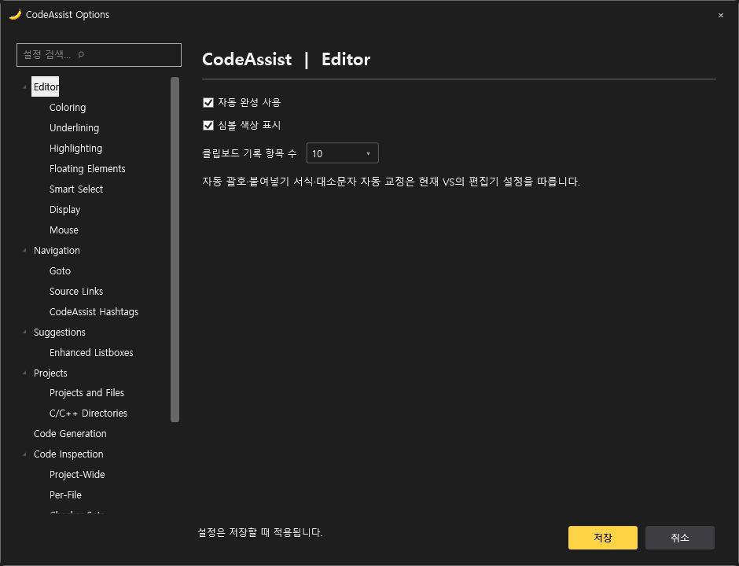
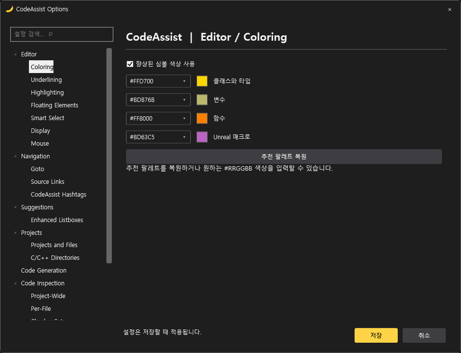
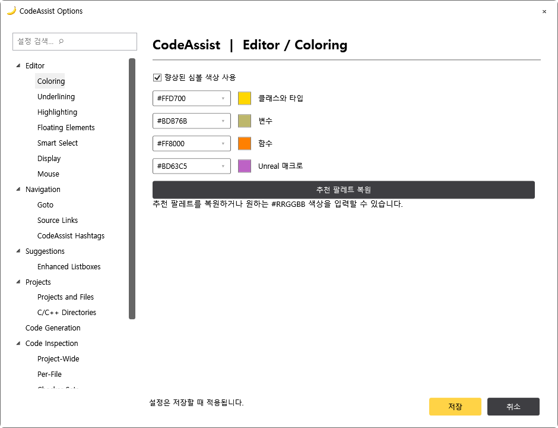
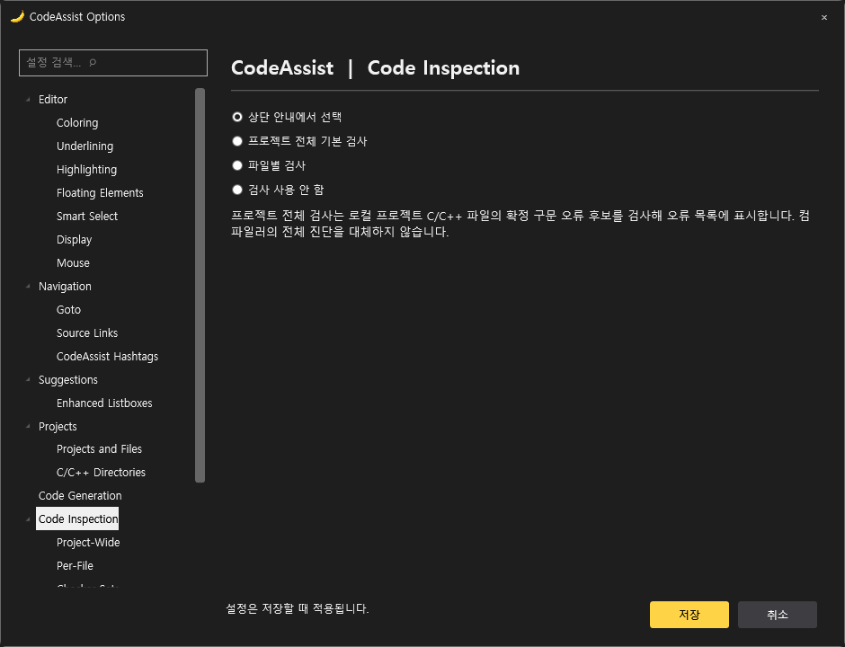

# CodeAssist 인터페이스 — 0.0.55

## 언어·선택 옵션·추천 색상 보강 — 0.0.64

[한국어/영어 언어 설정과 전체 번역표](localization.html)를 추가했습니다. 회귀115개 통과. 함수 추천 색상과 한국어 Smart Select 토글은 실제0.0.63 IDE에서 확인했습니다.0.0.64는 언어 테이블의 언어 자동 등록을 보강했습니다. 전체 VA 옵션 동등성은 미완료입니다.

## 동기화율·구현율 재점검

[현재 감사 결과](progress-audit.html): 회귀103개 통과, 패키지6개 및 등록 키24개 검사 통과. 부분 대응26/108(24.1%)는 구현 완성률이 아닙니다. 전체 구현 완료 검증0/108, VA 완전 동등성 검증0/108이며 실제 완성도·유사도는 미확인입니다. Welcome은 실제 클릭 검증 통과를 별도 기록했습니다.

## 실제 PC 클릭 검증 완료 — 0.0.61

2026-10-15 Computer Use의 공식 node_repl MCP와 @oai/sky로 실행 중 Visual Studio를 직접 조작했습니다. 0.0.60의 오류 대화상자와 InitializeEditorInstance의 0x80070057 실패를 재현했습니다. 0.0.61은 등록된 편집기를 VsShellUtilities.OpenDocumentWithSpecificEditor로 열어 VS가 MiscFiles 프로젝트와 문서 항목을 결정하도록 변경했습니다. 이전 실패에서 어느 개별 인수가 원인이었는지는 확정하지 않습니다.

설치한 0.0.61의 바이너리6개 해시를 패키지와 대조했습니다. 실제 VAParityFixture 솔루션에서 시작 시 Welcome 표시 → 문서 탭 닫기 → 두 번째 바나나(Welcome) 클릭 → 문서 탭 재열기 → 같은 버튼 반복 클릭 후 Welcome 탭1개 유지를 확인했습니다. 코드 main.cpp 탭과 같은 문서 영역에 표시됩니다. 로그의 CreatedDocumentFrame type=1 및 ReusedDocumentFrame도 대조했습니다. 이 결과는 Welcome 흐름에 한정하며 다른 기능 전체의 동등성 검증은 아닙니다.

[실제 UI 검증 기록](validation/welcome-live-ui-0.0.61.json) · [설치 확인](validation/install-0.0.61.json) · [호스트 로그](validation/welcome-native-0.0.61.log).

분석율: 명세108/108(100%, 문서 기준), 전체 역분석 미확인. VA 동기화율: 완전 검증0/108(0%), 부분 구현 대응26/108(24.1%). 미완료: VA 전체 동작·Undo·성능 비교와 미지원 기능. Welcome 추가 요구사항의 통과를108개 전체 기능 통과로 계산하지 않습니다.

## 이전 검증 이력 (아래 미검증 표기는 당시 상태)

## 실행 중 진단과 Welcome 생성 경로 수정 — 0.0.59

사용자가 0.0.58에서도 무반응을 확인했습니다. [클릭 로그](validation/welcome-native-failure-0.0.58.log)의 0.0.58 MVID=757f43aa-bf81-4060-af35-3bbfe6bef273 기록은 WelcomeCommandInvoked → OpenSpecificEditor → MapLogicalView까지 도달하며 편집기 생성/프레임 표시 기록은 없습니다. 버튼 등록 실패 가설은 이 실행 로그와 맞지 않습니다. MapLogicalView 뒤 중단의 정확한 원인은 아직 미확인입니다.

켜져 있는 Visual Studio PID22696에 Microsoft ClrMD의 읽기 전용 프로세스 스냅샷을 연결했습니다. 실제 로드된 CodeAssist.Extension/Core/Indexing 경로가 0.0.58 설치 폴더임을 확인했습니다. 채취 시점에는 Welcome 관련 실행 스택이 없었습니다. 이것은 과거 클릭 시점의 중단점·호출 스택 캡처가 아니며 교착을 증명하지 않습니다. [실행 중 진단](validation/welcome-live-process.json). 진단 소스는 tools/LiveVsDebugger에 보존했습니다. PC 마우스 조작이나 버튼 자동 클릭을 수행한 것은 아닙니다.

0.0.59 변경:

- 전용 문서 편집기는 유지하고, OpenSpecificEditor에 이름이 명시된 Welcome physical view를 넘겨 로그가 끝난 암시적 MapLogicalView 조회 경로를 거치지 않도록 했습니다.
- MapLogicalView도 Primary에 Welcome을 반환합니다. 미지원 논리/물리 뷰는 거절합니다.
- Welcome 자동 열기를 패키지의 모든 초기화 await 이후에 예약합니다. 초기화 중 클릭은 보류하고 완료 후 처리합니다. 중복 열기 재진입을 막습니다. 기존 초기화 시점 문제는 가능성에 대한 예방 수정이며 교착의 확정 원인으로 계산하지 않습니다.
- OpenSpecificEditor의 실제 반환 HRESULT와 frame 유무를 기록하고, S_FALSE/null frame을 성공으로 처리하지 않습니다. 팩터리 진입 기록을 UI 스레드 검사보다 앞에 두고 스레드 검사 실패도 기록합니다.
- ActivityLog 서비스가 없을 때 진단 로그 자체가 편집기 동작을 중단시키지 않도록 했습니다. 오프라인 검사에서 기존 로거가 서비스 부재로 예외를 내는 것을 재현했습니다. 실제 VS 무반응 원인이라는 뜻은 아닙니다.

Release 빌드, 패키지6바이너리·24단축키, 명령 연결, DocData COM, 메서드 표시, 이름 있는 뷰 매핑과 미지원 뷰 거절 검사가 통과했습니다. **실제 VS의 새 빌드 문서 표시·닫기·재열기는 미검증**입니다. [뷰 매핑 검사](validation/welcome-view-mapping.json) · [설치 상태](validation/install-0.0.59.json).

명세 확보율108/108(100%, 문서 기준), 전체 역분석 미확인. VA 동기화율 완전 검증0/108(0%), 부분 구현 대응26/108(24.1%). 미완료: 새 빌드 적용 및 실제 Welcome 수명 검증, 원본 기능별 비교.

## Welcome 명령 등록 보강 — 0.0.58

0.0.57에서 두 번째 바나나가 무반응이라는 사용자 보고를 실패로 유지합니다. 명령 등록이 OleMenuCommandService로 캐스팅되지 않으면 아무 오류 없이 건너뛰던 경로를 IMenuCommandService 인터페이스 기반 등록으로 변경했습니다. 서비스가 없으면 명시적으로 실패하며, 등록 전 UI 스레드로 전환합니다. 실제 VS에서 캐스팅 실패가 발생했는지는 미확인입니다.

실제 VSCT의 두 번째 도구 모음 항목과 명령 GUID/ID를 읽고, 실제 MenuCommandService에 등록한 뒤 Invoke하여 Welcome 콜백만 실행되는 것을 확인했습니다. Settings 콜백 분리와 서비스 누락 시 실패도 검사했습니다. 이는 명령 등록·연결 회귀 검사이며 실제 Visual Studio 버튼 클릭 성공을 검증한 것은 아닙니다. [연결 검사](validation/welcome-command-routing.json).

전용 문서 편집기·팩터리는 유지합니다. StartupCommandsRegistered → WelcomeCommandInvoked → PrepareWelcomeDocument → OpenSpecificEditor → MapLogicalView/CreateEditorInstance → CreatedDocumentFrame 단계 기록을 추가하여, 무반응이 명령 전달 이전인지 문서 생성 중인지 구분합니다. 로그는 %LOCALAPPDATA%/CodeAssist/Welcome-host.log에 남습니다. 과거 로그를 새 빌드 성공 증거로 사용하지 않습니다.

0.0.58 Release 빌드, 패키지6개 바이너리·단축키24개 검사, 메서드 표시·DocData COM 계약·버튼 연결 회귀 검사가 통과했습니다. **실제 IDE Welcome 열기·닫기·재열기는 아직 미검증이며, 무반응 해결 완료로 보고하지 않습니다.** [설치 상태](validation/install-0.0.58.json).

명세 확보율108/108(100%, 문서 기준), 전체 역분석 미확인. VA 동기화율 완전 검증0/108(0%), 부분 구현 대응26/108(24.1%). 미완료: 실제 Welcome 표시와 수명 검증, 기능별 VA 비교.

## Welcome 재발 확인과 비율 산정 — 0.0.57

**0.0.57 설치 완료:** 공식 설치 도구 종료 코드0, 설치 manifest와 바이너리6개 SHA256 일치 확인. 실제 IDE Welcome 클릭 성공은 미검증입니다. [설치 검증](validation/install-0.0.57.json).

사용자가 0.0.56 설치 후에도 Welcome 실패를 확인했습니다. 보존한 [실제 로그](validation/welcome-native-failure-0.0.56.log)에서 CreateDocumentWindow가 두 번 E_INVALIDARG(0x80070057)를 반환했습니다. 경로 변경으로 해결되지 않았으며, 어떤 인수가 거절됐는지는 미확인입니다. 이전 경로 가설은 확인된 원인으로 사용하지 않습니다.

직접 CreateDocumentWindow 호출을 제거하고 등록된 WelcomeEditorFactory·명시적 IVsPersistDocData·OpenSpecificEditor 경로로 교체했습니다. 문서 데이터는 변경 없음·저장 불가로 처리하며, 같은 프레임 재사용 및 닫힘을 기록합니다. 새 로그에는 빌드 MVID와 프레임 타입=1 성공/재사용/닫힘을 기록합니다. 창 타입 검사를 통과하지 않으면 성공으로 처리하지 않습니다.

0.0.57 Release 빌드, 편집기 등록을 포함한 패키지(바이너리6개·단축키24개) 검사, 메서드 표시 회귀 검사, DocData COM QueryInterface·편집기 GUID·clean 상태·저장 불가 계약 검사가 통과했습니다. **실제 VS UI 스레드의 팩터리 생성·Welcome 열기·닫기·재열기는 아직 미검증**입니다. 이번에도 빌드/오프라인 검사를 네이티브 성공으로 바꾸어 보고하지 않습니다. [검사 결과](validation/welcome-editor-contract.json).

### 구현률과 VA 동기화율의 계산

108개 공개 기능의 [기능별 검증표](validation/feature-verification-matrix.json)를 생성하고 tools/VerifyFeatureCoverage.py로 ID 중복·분모·부분 구현 집계 일치를 확인했습니다. 이 도구는 실제 VA를 실행하는 비교 테스트가 아닙니다.

| 지표 | 분자 기준 | 현재 결과 |
|---|---|---|
| 문서 기반 명세 확보 | 문서·설치 도움말 기반 부분 명세가 있는 항목 |108/108(100%). 전체 역분석 완료율 아님|
| 부분 구현 대응 | 기존 소스 대응 분류가 partial인 항목 |26/108(24.1%). 완성률 아님|
| 구현 완료 검증률 | 합의한 전체 시나리오와 적용 가능한 검증 관문을 CodeAssist에서 모두 통과 |증거 확보0/108(0%). 실제 구현 완성도는 미확인|
| VA 동기화 검증률 | 위 구현 검증에 더해 VA2630과 동일 조건의 실제 비교를 모두 통과 |증거 확보0/108(0%). 실제 유사도를 0%라고 뜻하지 않음|

기능별로 동작, 편집/Undo, 메뉴·단축키, 설정·기본값, 취소·창 수명, 지원 범위, 성능의 7개 관문을 둡니다. 해당되지 않는 관문은 근거와 이유를 기록합니다. 기능은 관문 일부만 통과해도 완성 항목으로 계산하지 않습니다.

동일 VS 버전과 동일 fixture 파일·커서·옵션에서 **VA만 활성화한 실행과 CodeAssist만 활성화한 실행**을 별도로 기록합니다. 사용자 스크린샷에는 두 확장의 안내바가 함께 표시되어 있으므로 그것만으로 단독 성능·색상·완성 동등성을 판정할 수 없습니다. 결과 목록·위치·범위·편집 내용·Undo·키 충돌·기본값·테마·닫기/재열기를 비교하고, 실제 프로젝트 C:/Projects/UnrealTestProject에서도 별도 검사합니다.

각 시나리오에는 IDE/확장 버전, DLL 및 입력 파일 SHA256, 기대/실제 결과, 원본 로그·화면을 보존합니다. 성능은 콜드/웜 구분, p50/p95 지연, CPU·메모리를 별도로 측정하고 VA 측정 후 허용 기준을 정합니다. 미실행·실패·다른 빌드의 증거는 통과로 계산하지 않습니다. 새 기능·세부 요구사항이 발견되면 버전이 명시된 분모를 확장합니다. Welcome 등 공개108항목 밖의 제품 요구사항도 별도 실패/검증 목록으로 유지합니다.

명세 확보율108/108(100%, 문서 기준), 전체 역분석 미확인. VA 동기화율 완전 검증0/108(0%), 부분 구현 대응26/108(24.1%). 미완료: 실제 Welcome 호스트 검증, 기능별 원본·재구현 비교 실행, 구현 완료율 증거 확보, 전체 기능 동등성.

## Welcome 버튼 오류 대응 — 0.0.56

**배포 상태:** 0.0.56 패키지 생성·6개 바이너리 일치·24개 단축키 등록 검사, WPF 화면 9개 및 버튼 관련 오프라인 회귀 검사 통과. Visual Studio 실행 중이므로 설치는 보류했습니다. 현재 실행 중인 IDE에는 적용되지 않았습니다. [설치 상태](validation/install-0.0.56.json).

두 번째 바나나는 Welcome 명령(0x140)입니다. 사용자가 0.0.55에서 클릭한 뒤 Visual Studio의 “값이 예상 범위를 벗어났습니다” 오류를 보고했습니다. **0.0.55의 실제 Welcome 호스트 동작은 실패한 것으로 기록하며, 오프라인 화면 검사를 성공 근거로 대체하지 않습니다.**

- 기존 문서 식별자 codeassist://welcome은 .NET Framework의 Path.GetFullPath에서 NotSupportedException을 발생시켰습니다. SDK가 요구하는 Windows 문서 경로로 바꾸고 NonCreatable·VirtualDocument 플래그를 추가했습니다. 실제 오류가 이 식별자 때문인지는 아직 미확인입니다.
- Welcome 생성·프레임 타입 확인·ViewHelper 등록·표시 중 실패 단계를 %LOCALAPPDATA%/CodeAssist/Welcome-host.log와 ActivityLog에 HRESULT와 함께 기록합니다. 실패 시 원래 예외를 정리 오류로 덮어쓰지 않습니다. WelcomeSeen은 성공 시에만 저장합니다.
- Context Bar의 SemanticToken 타입 이름 표시를 오프라인 WPF에서 재현했습니다. 공통 ComboBox의 템플릿 선택기·문자열 형식 전달을 복구하고 메서드에 명시적 Name 템플릿을 적용했습니다. 수정 후 BeginPlay 표시를 확인했습니다.
- 도구 모음의 두 버튼에 옵션/Welcome 툴팁을 명시했습니다.

[회귀 검사](validation/welcome-button-regression.json). 실행 도구: tools/VerifyWelcomeButton.ps1. 이 검사는 기존 템플릿 표시 문제와 경로 유효성을 재현하며 **실제 VS의 CreateDocumentWindow 호출이나 버튼 클릭 성공을 검증하지 않습니다.** 네이티브 오류 해결 여부는 미확인입니다.

공식 계약: [CreateDocumentWindow](https://learn.microsoft.com/en-us/dotnet/api/microsoft.visualstudio.shell.interop.ivsuishell.createdocumentwindow?view=visualstudiosdk-2022), [RDT 플래그](https://learn.microsoft.com/en-us/dotnet/api/microsoft.visualstudio.shell.interop._vsrdtflags?view=visualstudiosdk-2022).

명세 확보율 108/108(100%, 문서·도움말 기준), 전체 역분석 진행률 미확인. VA 동기화율 완전 검증 0/108(0%), 부분 구현 대응 26/108(24.1%). 미완료: 실제 VS Welcome 열기·닫기·재열기, 전체 IDE 통합 검증, 미지원 기능 및 VA 전체 동등성.

첨부하신 화면의 검사 안내바·설정 버튼·옵션 트리·Welcome 구성을 CodeAssist의 이름·바나나 아이콘·노란 강조색으로 구현했습니다. **아래 이미지는 구현한 WPF 뷰의 오프라인 렌더링이며 실제 VS 화면 캡처가 아닙니다.**

## Welcome 문서 페이지

코드 파일과 같은 문서 프레임에서 생성합니다. 브랜드·큰 제목·도움말 버튼·새 기능 카드·학습·피드백·단축키 영역을 구성했습니다. 도움말은 VSIX에 포함한 오프라인 HTML입니다. 피드백은 클립보드로 복사하며 외부로 자동 전송하지 않습니다.

## CodeAssist Options

작은 바나나 아이콘이 있는 CodeAssist 도구 모음의 설정 버튼 또는 Tools → CodeAssist: Settings에서 엽니다. 검색·분류 트리·오른쪽 설정·저장/취소·테마 제목 표시줄을 구성했습니다.

설정은 초안으로 편집합니다. 취소하거나 저장에 실패하면 기존 설정을 유지합니다. Enter는 저장, Esc는 취소에 연결했습니다.

|설정|실제 연결|
|---|---|
|자동 완성|CodeAssist 완성 공급자 활성화|
|심볼 색상·팔레트|클래스·변수·함수·Unreal 매크로 색상 맵과 열린 문서 갱신|
|클립보드 기록 수|1~50개 용량 변경, 최신 항목 유지|
|Context Bar|C/C++ 편집기 위 파일 경로·함수 후보·Go·대응 파일|
|검사 모드|프로젝트 기본 구문 검사 / 파일별 검사 / 비활성 / 안내에서 선택|
|편집 후 갱신 대기|문서 인덱스 입력 합치기 대기를50~1000ms로 변경|
|시작·안내 설정|Welcome 시작 표시와 상단 안내 숨김|

**미지원 범주는 안내만 표시합니다.** 자체 자동 괄호·붙여넣기 서식·대소문자 자동 교정, 외부 Source Links 규칙 편집, AI·에이전트·전용 디버그·GPU 분석기를 구현한 것으로 계산하지 않습니다. 분류 항목의 존재와 기능 동등성은 다릅니다.

## 상단 안내와 편집기 바

솔루션이 열려 있고 검사 모드를 선택하지 않았으면 프로젝트 이름과 Enable · Disable · Use per-file engine을 표시합니다.

- Enable: 로컬 프로젝트 C/C++ 기본 구문 검사를 백그라운드에서 실행하고 오류 목록에 결과를 표시합니다.
- Disable: CodeAssist 진단을 끄고 진행 중인 검사를 취소합니다.
- Use per-file engine: 열린 파일의 기존 진단을 사용합니다.
- Welcome / Options: 문서 페이지와 옵션 창을 엽니다.

검사 선택은 현재 사용자 단위로 저장합니다. 솔루션별 기본값 체크박스는 미구현입니다. 프로젝트 전체 검사는 괄호·제어문 구문 후보 검사이며 VA/clang-tidy 전체 분석과 같지 않습니다.

Context Bar는 현재 파일 경로·함수 후보 목록·Go·대응 파일 버튼을 제공합니다. 목록은 펼칠 때만 분석합니다. 선언·호출을 구분하는 컴파일러 기반 메서드 목록과는 차이가 있습니다.

## 검증과 설치

- Release 빌드와 바이너리6개·단축키24개·도구 모음·설정 배치·오프라인 도움말 패키지 검사.
- 자동 회귀 테스트 **103개 통과**: 초안 격리·저장 실패 복구·클립보드 용량·프로젝트 검사·취소 포함.
- 오프라인 WPF 화면 **9개** 및 선택 컨트롤 명암 대비 검사 통과.
- 밝은/어두운 색상 페이지에서 잘못된 색상 저장 차단, 정상 색상 저장 활성화, 초안 격리, 키워드 검색 필터 검사 통과.
- 실제 C:/Projects/UnrealTestProject 파일4개 기본 검사: 발견0개,135.8ms. 콜드 JIT를 포함한 단일 헤드리스 실행이며 VS·VA 속도 비교가 아닙니다.
- **0.0.55 설치 완료**: 설치 manifest와 바이너리6개 해시가 Release 빌드와 일치합니다.

[화면 검사](validation/product-view-checks.json) · [입력 검사](validation/options-coloring-dark.png.interactions.json) · [프로젝트 검사](validation/project-inspection-unreal.json) · [종합 근거](validation/product-surfaces.json) · [설치 검증](validation/install-0.0.55.json)

**실제 VS의 문서 탭·도구 모음·InfoBar·Context Bar·오류 목록을 클릭 검증한 것은 아닙니다.** 현 세션에 Windows UI 조작 도구가 없어 해당 호스트 동작은 미확인입니다.

명세 확보율 **108/108(100%, 문서 기준)** · 전체 역분석 진행률 **미확인** · VA 동기화율 **완전 검증0/108(0%), 부분 구현 대응26/108(24.1%)**.

미완료: 실제 IDE 통합·배치·재열기·입력 지연 검증, 미지원 설정과 전체 검사 엔진, VA 전체 기능 동등성.
