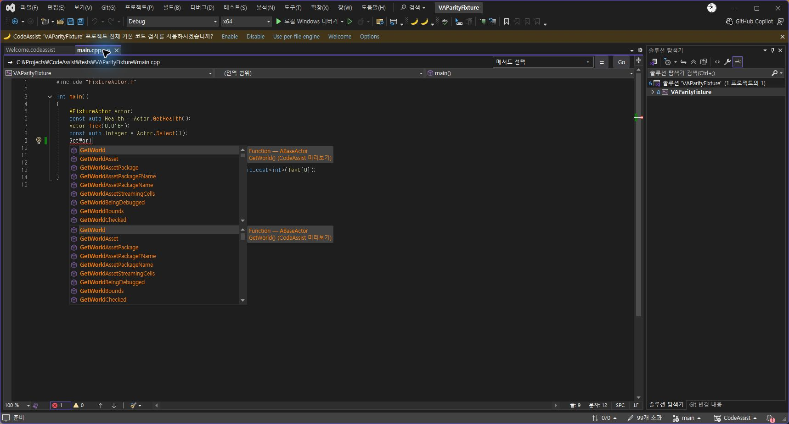
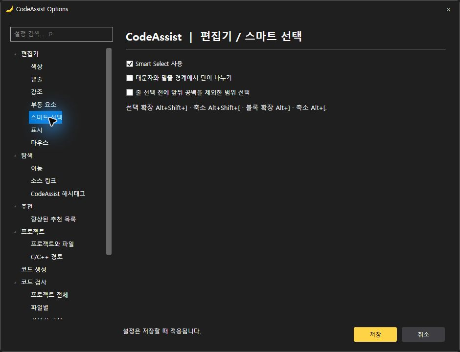
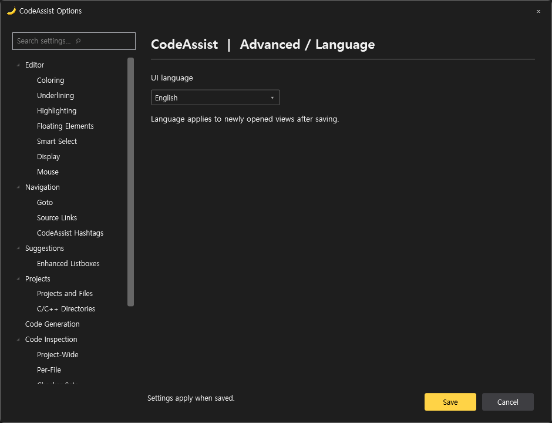

# 언어 설정·번역 테이블

설정 → 고급 → 언어에서 시스템 언어 / 한국어 / English를 선택하고 저장합니다. 선택은 startup.xml의 UiLanguage에 보존됩니다. 저장 후 새로 여는 옵션·Welcome에 적용됩니다. 이미 열린 화면의 언어를 즉시 교체하는 기능은 아직 없습니다.

## 새 언어 추가

원본 표는 `CodeAssist.Core/Localization/ui.xml`이며 Core 어셈블리에 포함됩니다. 각 entry의 key와 source는 유지하고 `<text lang="ja">번역</text>`처럼 언어 열을 추가합니다. 테이블에 추가된 언어는 선택 목록에 자동으로 나타납니다. 변경 후 빌드·설치가 필요합니다. 지역 코드(ko-KR)는 정확한 번역 → ko → en 순으로 조회하며, 없는 문구는 원문으로 표시합니다. XML 특수문자는 이스케이프해야 합니다. DTD/외부 엔터티는 허용하지 않습니다.

현재 범위는 옵션 페이지와 Welcome의 등록된 문구입니다. VS 자체 메뉴와 기존 명령·진단·InfoBar 모든 문자열의 번역까지 완료한 것은 아닙니다.

## 이번 구현 및 검증

- Smart Select 사용 여부, 대문자·밑줄 단어 분리, 줄 전체 선택 전 공백 제외 범위 선택을 실제 명령에 연결했습니다. 기본값은 기존 CodeAssist 동작을 보존하며 VA 공장 기본값과 동일하다고 검증하지 않았습니다.
- 실제0.0.64 IDE에서 함수 추천 목록·도움말의 주황색 표시와 Welcome 문서 탭 시작 표시를 재확인했습니다. 한국어 Smart Select 토글 화면은0.0.63 IDE에서 확인했습니다.0.0.64는 언어 목록을 테이블에서 자동 생성하도록 보강했습니다.
- 회귀115개 통과. 한국어/영어/지역 코드/영어 fallback·설정 복사·단어 경계·선택 축소 복원 검사를 포함합니다.
- 옵션의 다른 미지원 범주와 전체 토글의 VA 동등성은 미완료입니다.

## 번역표

|안정 키|한국어|영어|
|---|---|---|
|ui.5fb926229090|저장|Save|
|ui.be876433993a|취소|Cancel|
|ui.1e8c10206f5b|닫기|Close|
|ui.dc13dbfbfaf2|설정 검색|Search settings|
|ui.b2b93c0fe82d|설정 검색…  ⌕|Search settings…  ⌕|
|ui.7f6e8753f903|설정은 저장할 때 적용됩니다.|Settings apply when saved.|
|ui.3e06fafb2485|색상은 #RRGGBB 형식으로 입력하세요.|Enter a color in #RRGGBB format.|
|ui.0a742e39bd6b|자동 완성 사용|Enable code completion|
|ui.1d908a61a7ba|심볼 색상 표시|Color symbols|
|ui.77933ce40141|클립보드 기록 항목 수|Clipboard history items|
|ui.e3f68552b5dc|자동 괄호·붙여넣기 서식·대소문자 자동 교정은 현재 VS의 편집기 설정을 따릅니다.|Automatic brackets, paste formatting and case repair currently use Visual Studio settings.|
|ui.d642458e7e5f|향상된 심볼 색상 사용|Enable enhanced symbol coloring|
|ui.ec05f530725f|클래스와 타입|Classes and types|
|ui.541034c474b7|변수|Variables|
|ui.16a8523fe90a|함수|Functions|
|ui.35a733f3603c|Unreal 매크로|Unreal macros|
|ui.0594b124faea|추천 팔레트 복원|Restore recommended palette|
|ui.66d03af33c6b|추천 팔레트를 복원하거나 원하는 #RRGGBB 색상을 입력할 수 있습니다.|Restore the recommended palette or enter a #RRGGBB color.|
|ui.f2f8eccd001f|파일 내 기본 코드 진단 사용|Enable basic file diagnostics|
|ui.01b0ab0cd521|확정 구문·스코프 오류 후보를 표시합니다. 컴파일러 전체 진단과 동일하지 않습니다.|Show syntax and scope issue candidates. This is not a full compiler diagnostic engine.|
|ui.b02e85c63043|Find Selected: Alt+K · 다음/이전 선택 항목 이동은 기존 명령을 사용합니다.|Find Selected: Alt+K. Use the existing commands for next/previous matches.|
|ui.61935cdc25a7|단축키 도움말|Keyboard shortcut help|
|ui.66e09c36971c|빠른 작업은 Alt+Shift+Q로 엽니다. 부동 빠른 작업 툴바는 현재 지원하지 않습니다.|Open Quick Actions with Alt+Shift+Q. A floating action toolbar is not yet supported.|
|ui.e2622fbee4fd|Smart Select 사용|Enable Smart Select|
|ui.ff9944bb0741|대문자와 밑줄 경계에서 단어 나누기|Split words at case changes and underscores|
|ui.7ff7418ae8b3|줄 선택 전에 앞뒤 공백을 제외한 범위 선택|Select trimmed line contents before the entire line|
|ui.d00d2b7f0d08|선택 확장 Alt+Shift+] · 축소 Alt+Shift+[ · 블록 확장 Alt+] · 축소 Alt+[.|Extend Alt+Shift+] · Shrink Alt+Shift+[ · Extend block Alt+] · Shrink block Alt+[.|
|ui.e14faa46b4e1|편집기 상단 Context Bar 표시|Show Context Bar above the editor|
|ui.66da30755409|파일 경로·메서드 이동·관련 파일 명령을 편집기 위에 표시합니다.|Show file paths, method navigation and related file commands above the editor.|
|ui.97c9d50080f5|기본 마우스 동작은 Visual Studio 설정을 사용합니다.|Mouse behavior uses Visual Studio settings.|
|ui.1dac55f3f882|Alt+G 정의/구현 · Alt+O 대응 파일 · Alt+Shift+S 심볼 · Alt+Shift+O 파일.|Alt+G definition/implementation · Alt+O corresponding file · Alt+Shift+S symbols · Alt+Shift+O files.|
|ui.ad4fc2bbc816|명령과 단축키는 설치된 CodeAssist 명령 테이블을 사용합니다. 기존 키보드 설정을 덮어쓰지 않습니다.|Commands use the installed CodeAssist command table. Existing keyboard settings are preserved.|
|ui.9913118adfe6|외부 소스 링크 규칙 편집기는 미구현입니다.|An external source link rule editor is not yet implemented.|
|ui.13cb441d7cec|주석의 #태그를 Alt+Shift+H로 검색합니다.|Search comment #tags with Alt+Shift+H.|
|ui.bebb6c42196b|CodeAssist 자동 완성|CodeAssist completion|
|ui.d0d3eac9f65b|C/C++ 완성 후보와 clangd 기반 후보를 결합합니다. 표시 결과는 프로젝트 구성과 인덱스 상태에 영향을 받습니다.|Combine C/C++ and clangd candidates. Results depend on project configuration and index readiness.|
|ui.d6d749c48e39|범용 C/C++ 프로젝트를 지원하며 Unreal은 추가 지원 대상입니다.|Support general C/C++ projects with additional Unreal support.|
|ui.244a7891c915|현재 프로젝트의 파일과 심볼을 인덱싱합니다. 엔진·시스템 헤더 캐시는 프로젝트 심볼과 분리합니다.|Index project files and symbols. Engine/system header caches are separate.|
|ui.022c6ed7510d|포함 경로는 프로젝트 컴파일 구성에서 읽습니다. 사용자 경로 편집은 아직 제공하지 않습니다.|Read include paths from project compilation settings. Editing custom paths is not yet supported.|
|ui.8238bc5fd540|선언 만들기 Alt+Shift+C · 스니펫 삽입은 CodeAssist 메뉴에서 실행합니다.|Create from Usage: Alt+Shift+C. Insert snippets from the CodeAssist menu.|
|ui.c479af03cc48|프로젝트 전체 기본 검사|Project-wide basic inspection|
|ui.a4b1a4ed4cd7|파일별 검사|Per-file inspection|
|ui.b89fbbee189f|검사 사용 안 함|Disable inspections|
|ui.b7e3effedd7b|상단 안내에서 선택|Ask in the notification bar|
|ui.7933e9a76776|파일별 검사 활성화|Enable per-file inspection|
|ui.8835e23178fe|프로젝트 전체 검사는 로컬 프로젝트 C/C++ 파일의 확정 구문 오류 후보를 검사해 오류 목록에 표시합니다. 컴파일러의 전체 진단을 대체하지 않습니다.|Check local project C/C++ syntax issue candidates and show results in Error List. This does not replace full compiler diagnostics.|
|ui.9b0835261899|프로젝트 전체: 괄호·제어문 구문 검사. 파일별: 타입 대소문자·식별자·구문·스코프 후보 검사. 추가 검사기는 미구현입니다.|Project: delimiter/control-flow checks. Per file: type case, identifier, syntax and scope candidates. Additional checkers are not implemented.|
|ui.34d52682f8d0|로컬 AI·에이전트 연결은 현재 구현하지 않았습니다.|Local AI and agent integration is not yet implemented.|
|ui.0d90ef527728|전용 디버그 보조 기능은 현재 지원하지 않습니다.|Dedicated debugging assistance is not yet supported.|
|ui.f06777473271|Unreal 반사 매크로와 메타 지정자·엔진 심볼을 지원합니다. GPU 전용 분석기는 미구현입니다.|Support Unreal reflection macros, metadata and engine symbols. A GPU analyzer is not implemented.|
|ui.ac160f848818|시작할 때 Welcome 문서 열기|Open Welcome at startup|
|ui.317b69fc0dfd|상단 안내바 표시|Show notification bar|
|ui.c38ae6888911|CodeAssist 문서|CodeAssist documentation|
|ui.10458a1021da|편집 후 문서 인덱스 갱신 대기 (ms)|Document index update delay after editing (ms)|
|ui.835b8ad3b6cd|빠른 입력 중 중복 분석을 합칩니다. 초기 인덱싱 시간은 프로젝트 구성에 따라 다릅니다.|Coalesce analysis during rapid input. Initial indexing depends on project configuration.|
|ui.5f9f2e875929|CodeAssist에 오신 것을 환영합니다. 권장 설정을 확인하고 저장하세요.|Welcome to CodeAssist. Review and save the recommended settings.|
|ui.529efaf7d647|이 범주는 현재 지원하지 않습니다. 제공되는 기능은 관련 설정에서 사용할 수 있습니다.|This category is not yet supported. Available features are accessible in the related settings.|
|ui.7aabb6fb160c|코드를 이해하고, 원하는 위치로 이동하고, 더 빠르게 편집하세요.|Understand code, navigate to what matters, and edit faster.|
|ui.bc4bb57b266c|주요 기능|Top features|
|ui.086f41200b47|단축키|Keyboard shortcuts|
|ui.689e9f028ed8|프로젝트의 C/C++ 기본 구문 검사 결과를 오류 목록에서 확인하세요.|Review basic project C/C++ syntax inspection results in Error List.|
|ui.de15e9aa7097|심볼 팔레트와 자동 완성·클립보드 설정을 한곳에서 조정하세요.|Adjust symbol colors, completion and clipboard settings in one place.|
|ui.dde85d659a93|파일·심볼·메서드·대응 파일을 단축키와 Context Bar로 찾으세요.|Find files, symbols, methods and corresponding files using shortcuts and Context Bar.|
|ui.13a23ecbbbb4|범용 C/C++ 작업 흐름에 Unreal 매크로와 엔진 탐색 지원을 더합니다.|Add Unreal macros and engine navigation to general C/C++ workflows.|
|ui.00a5dc5fc36f|설치·권장 색상·탐색·검사 기능의 사용 방법과 검증 범위를 확인하세요.|Read about installation, colors, navigation, inspections and verification scope.|
|ui.960d26982d32|오프라인 사용 안내|Offline user guide|
|ui.761de67b68ec|심볼 찾기 Alt+Shift+S|Find Symbol Alt+Shift+S|
|ui.4af75fce0a2c|파일 열기 Alt+Shift+O|Open File Alt+Shift+O|
|ui.9f1fdac99643|개선할 점이나 재현 방법을 적어 복사하세요. 내용은 자동 전송하지 않습니다.|Write feedback or reproduction steps and copy them. Nothing is sent automatically.|
|ui.41908a006476|피드백 내용|Feedback|
|ui.f5640cf6543f|피드백 내용 복사|Copy feedback|
|ui.d9381128c086|복사했습니다.|Copied.|
|ui.71af66d7c97f|클립보드에 복사하지 못했습니다. 잠시 뒤 다시 시도하세요.|Could not copy to the clipboard. Please try again.|
|ui.29b8dbb00979|Visual Studio 시작 시 Welcome 열기|Open Welcome when Visual Studio starts|
|ui.665cf081f45f|CodeAssist · 범용 C/C++ 개발 보조 · Unreal Engine 지원|CodeAssist · General C/C++ assistance · Unreal Engine support|
|ui.d870406c5d15|언어|Language|
|ui.42bf8c453699|UI 언어|UI language|
|ui.a575009cf3d5|언어는 저장 후 새로 여는 화면에 적용됩니다.|Language applies to newly opened views after saving.|
|ui.bee6f0eca84c|시스템 언어|System language|
|ui.936a161c3931|편집기|Editor|
|ui.931d37b7a209|색상|Coloring|
|ui.ad1668a5241d|밑줄|Underlining|
|ui.7a4a9fe7f2da|강조|Highlighting|
|ui.2f5995fe5981|부동 요소|Floating Elements|
|ui.f1326d00cced|스마트 선택|Smart Select|
|ui.34e108c0896d|표시|Display|
|ui.55c1520824a8|마우스|Mouse|
|ui.3db65f8c2a7d|탐색|Navigation|
|ui.f1079111a1c1|이동|Goto|
|ui.1daa9b7c7fe5|소스 링크|Source Links|
|ui.20e2990eaf99|CodeAssist 해시태그|CodeAssist Hashtags|
|ui.16c1d601fc66|추천|Suggestions|
|ui.6717832dcbee|향상된 추천 목록|Enhanced Listboxes|
|ui.04e2a9728af7|프로젝트|Projects|
|ui.c98f7d5e8895|프로젝트와 파일|Projects and Files|
|ui.630e99629241|C/C++ 경로|C/C++ Directories|
|ui.6dd237e349c9|코드 생성|Code Generation|
|ui.faeb12c9dfa0|코드 검사|Code Inspection|
|ui.3dc198a486b5|프로젝트 전체|Project-Wide|
|ui.f24944c1eea3|파일별|Per-File|
|ui.73405b2fcb2a|검사기 구성|Checker Sets|
|ui.86db970426ef|CodeAssist 인텔리전스|CodeAssist Intelligence|
|ui.8c3fc9e4b991|디버그 보조|Debug Assistance|
|ui.a82acc52a7f9|게임과 GPU|Games & GPUs|
|ui.9f088dbebd6c|고급|Advanced|
|ui.442aded87a55|성능|Performance|
|ui.a4fe65264ef7|언어|Language|
|ui.d0db8b5e364b|설정|Options|
|ui.c205924de0fe|문서|Documentation|
|ui.700fe314615c|CodeAssist 설정|CodeAssist Options|

분석율: 명세108/108(100%), 전체 역분석 미확인. 구현율: 전체 완성률 미확인, 기존 부분 대응26/108(24.1%). VA 동기화율: 완전 검증0/108. 미완료: VA 전체 옵션·토글·기본값·위치·성능 비교와 나머지 구현.
