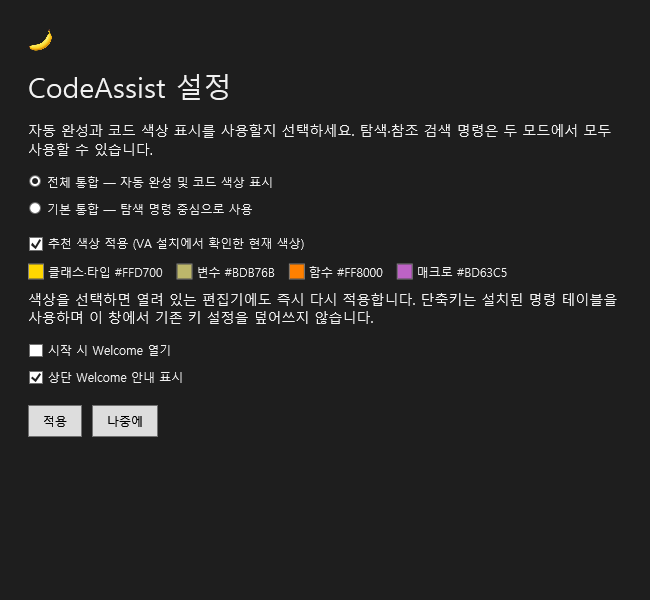
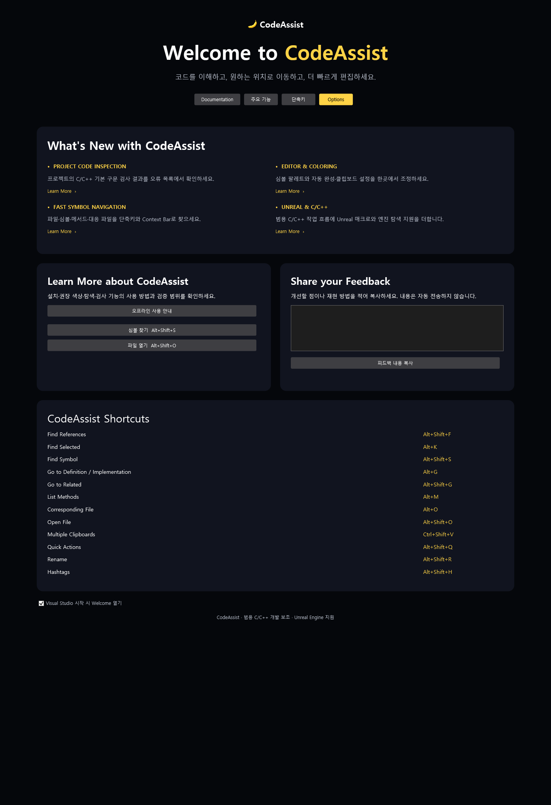
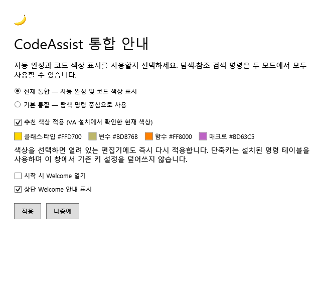
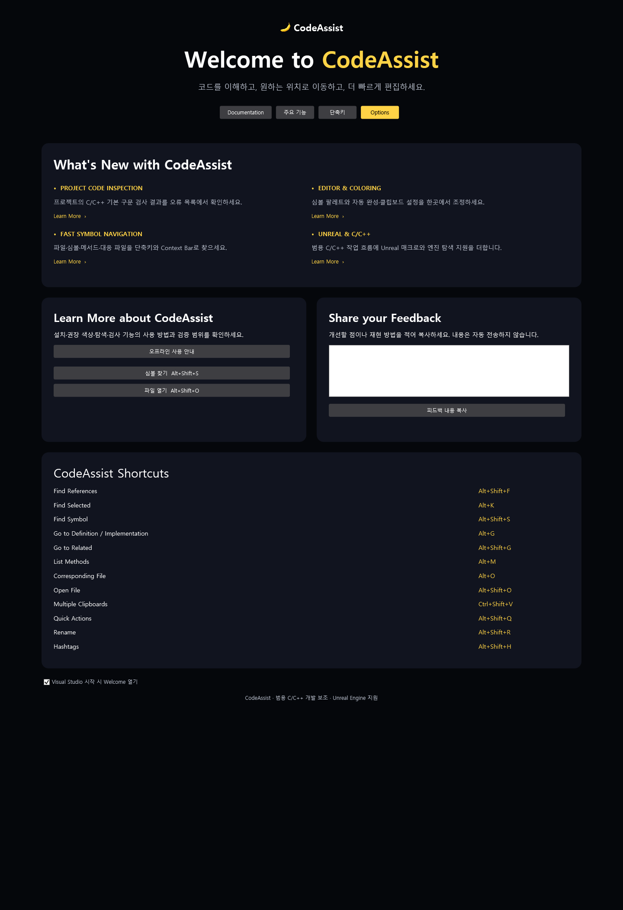
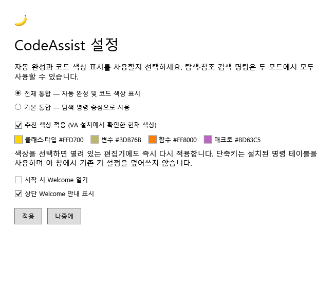

# 첫 실행 · Welcome · 설정

현재 패키지: **0.0.55**. 이번 사용자 지시에 따라 제품 구현을 재개했습니다. VA 전체 동등성이 완료되었다는 뜻은 아닙니다.

## 0.0.55 — CodeAssist 인터페이스 통합

최신 화면과 실제 설정 연결은 [CodeAssist 인터페이스](interface.md)에 정리했습니다. Welcome 브랜드·카드·학습·피드백·단축키 영역, 검색 가능한 옵션 트리, 바나나 설정 도구 모음, 검사 선택 안내, C/C++ Context Bar를 추가했습니다.

첫 실행도 새 Options를 사용합니다. 자동 완성·색상 등을 각각 선택하고 저장하면 설정 완료로 기록합니다. 기존 전체/기본 라디오 팝업은 더 이상 사용하지 않습니다. 미지원 범주는 안내만 표시하며 구현한 것으로 계산하지 않습니다.0.0.55 설치와6개 바이너리 해시를 확인했습니다. 실제 IDE 호스트 동작은 미확인입니다. 아래0.0.54 이하 내용은 변경 이력입니다.

## 0.0.54 — Welcome 문서 프레임으로 교체

사용자 스크린샷에서0.0.53 Welcome이 떠 있는 도구 창으로 표시되는 것을 확인했습니다. 도구 창에 MDI 모드를 설정하는 이전 접근을 폐기했습니다.

WelcomeDocumentPane은 ToolWindowPane이 아닌 WindowPane을 상속합니다. IVsUIShell.CreateDocumentWindow로 문서 프레임을 직접 생성하며, 생성 후 VSFPROPID_Type 값이 문서 프레임(1)인지 검사합니다. 기존 Welcome 도구 창 등록은 패키지에서 제거했습니다. 닫은 뒤 다시 열기와 중복 열기를 처리하고, 가상 Welcome 문서는 Save As·최근 파일·솔루션 재열기 대상에 추가하지 않습니다.

이는 [Visual Studio 문서 창 생성 API](https://learn.microsoft.com/en-us/dotnet/api/microsoft.visualstudio.shell.interop.ivsuishell.createdocumentwindow?view=visualstudiosdk-2022)의 계약에 맞춘 변경입니다. **컴파일·패키지 검증과 실제 UI 배치 확인은 구분합니다. 실제 편집기 탭 표시·재열기 동작은 미확인입니다.**

현재 Visual Studio 실행을 감지하여0.0.54 자동 설치를 보류했습니다. VS를 종료한 다음 루트의 CodeAssist.vsix를 설치해야 이 변경이 적용됩니다. [설치 상태 기록](validation/install-0.0.54.json).

## 0.0.53 — 다크 테마와 첫 실행 표시 순서 수정

사용자 스크린샷에서 어두운 배경에 라디오·체크박스 글자가 검게 표시되는 문제를 확인했습니다. 기존 WPF 선택 컨트롤의 기본 스타일이 검은 전경색을 사용하고, 창에 지정한 전경색만으로는 이 값을 대체하지 못했습니다. 각 선택 컨트롤 스타일을 VS ToolWindowTextBrushKey에 연결했습니다.

기존 렌더러가 밝은 배경·검은 글자를 강제로 지정했던 점도 수정했습니다. 설치됐던0.0.52 DLL로 다크 글자색 검사 실패를 재현했고,0.0.53에서 첫 실행·설정·Welcome의 밝은/어두운 테마 총6개 렌더링과 글자색 검사를 통과했습니다. 실제 VS 테마 전환 전체를 검증한 것은 아닙니다.

시작 순서는 **Welcome → 상단 InfoBar → 통합 설정 팝업**으로 변경했습니다. 기존에는 설정 팝업의 ShowDialog가 반환될 때까지 Welcome·InfoBar가 실행되지 않았습니다. Welcome 프레임에는 MDI 문서 영역 표시 모드를 요청하고, 지원되지 않으면 경고를 기록합니다. InfoBar 호스트가 준비되지 않으면500ms 간격으로 최대10회만 재시도합니다. 사용자가 안내를 숨긴 설정은 유지합니다.

[회귀 재현 로그](validation/dark-theme-before.log) · [다크 글자색 검사](validation/settings-dark-preview.png.json)

## 0.0.52 수정과 설치 확인

- 확인 당시 VS2022에 설치된 CodeAssist는 **0.0.49**였습니다. 이전 UEAssist 0.0.49도 같은 패키지 GUID로 함께 등록돼 있었습니다. 새 안내가 포함된 패키지는 당시 설치되어 있지 않았습니다. 중복 등록이 실제 CPU·색상 문제에 미친 영향은 미확인입니다.
- 이전 UEAssist 설치 파일을 .local/install-backups/UEAssist-0.0.49.zip으로 백업하고 공식 VSIXInstaller로 제거했습니다. CodeAssist **0.0.52 설치 종료 코드 0**, 설치 manifest와 바이너리 해시 일치를 확인했습니다.
- 설정에 **추천 색상 적용** 선택과 클래스·타입 #FFD700, 변수 #BDB76B, 함수 #FF8000, 매크로 #BD63C5 견본을 추가했습니다. 이는 VA 설치에서 관찰한 현재 색상이며 모든 테마의 공장 초기값이라는 뜻은 아닙니다.
- 바나나는 메뉴 16px 리소스·Welcome 탭과 안내바의 이미지 서비스·문서 파비콘 32px에 연결했습니다. 화면 제목 위 아이콘은 24px입니다.
- 편집 색상 분석의 심볼별 전체 텍스트 재검색과 함수별 선형 중복 탐색을 제거했습니다. 105,559자·2,000개 변수·6,000개 토큰에서 수정 전 176.9/172.4/177.2ms, 수정 후 42.3/28.9/27.8ms였습니다. 중앙값 기준 약6.1배입니다. **.NET8 분석 함수 측정이며 VS 전체 CPU·VA 비교가 아닙니다.**
- 첫 실행 UI 초기화를 패키지 초기화 앞부분으로 옮겼습니다. 실제 IDE의 팝업·색상·입력 지연은 UI 도구가 없어 아직 확인하지 못했습니다.

[설치 및 성능 기록](validation/startup-fix-0.0.52.json) · [수정 전](validation/editor-parser-before.json) · [수정 후](validation/editor-parser-after.json)

## 구현한 화면

- 첫 실행 안내: 전체 통합 또는 기본 통합을 선택합니다. 전체는 CodeAssist의 C/C++ 자동 완성과 색상 표시를 켜고, 기본은 두 기능을 끕니다. 탐색 명령은 유지합니다.
- Welcome 화면: VS의 문서 프레임으로 생성합니다. 심볼 찾기·파일 열기·설정 버튼과 주요 단축키를 표시합니다. 이전 ToolWindowPane 등록과 모드 변경 경로를 제거했습니다. 실제 VS 편집기 탭 표시 결과는 아직 검증하지 못했습니다.
- 상단 안내바: Visual Studio의 MainWindow InfoBar를 사용하며 Welcome·설정 링크와 닫기 동작을 제공합니다.
- 설정 창: Tools → CodeAssist: Settings에서 다시 열 수 있습니다. Welcome은 Tools → CodeAssist: Welcome으로 엽니다.
- 바나나 아이콘: 코드 기호를 제거하고 알아보기 쉬운 단일 바나나로 교체했습니다. 투명 PNG를 Welcome·설정과 VSIX 메타데이터에 적용했습니다. [원본 이미지](assets/codeassist-icon-master.png).

## 첫 실행과 저장

첫 실행 설정을 적용하면 완료 상태를 저장합니다. ‘나중에’ 또는 창 닫기는 설정 완료로 처리하지 않습니다. Welcome은 최초 한 번 열리며, 시작 시 열기 옵션을 켜면 다음 실행에도 표시합니다. 상단 안내바를 닫으면 다시 표시하지 않으며 설정에서 복구할 수 있습니다.

저장 위치는 사용자 LocalAppData의 CodeAssist/startup.xml입니다. 임시 파일로 기록한 뒤 교체하고 이전 파일은 startup.xml.bak로 보존합니다. 손상된 XML은 삭제하지 않고 기본값으로 읽습니다. 이 설정은 현재 VS 인스턴스별 구분 없이 사용자 단위로 공유됩니다.

색상 추천 체크박스와 색상 견본을 추가했습니다. 적용 시 편집기 형식 맵을 갱신하고 열린 문서의 색상을 다시 요청합니다. 기존 키 바인딩을 이 창에서 수정하지 않습니다. VA처럼 충돌을 비교하고 선택하여 적용하는 추천 단축키 대화상자는 미구현입니다.

## 확인한 근거와 차이

VA2630 설치 폴더의 FirstRun/firstRun.html과 Misc/welcome.mustache를 읽고 통합 안내·Welcome·단축키 안내 구성을 확인했습니다. 원본 HTML·템플릿이나 VA 바이너리를 제품에 포함하지 않았습니다. VA의 신규 AI 기능·동영상·피드백 송신을 구현한 것처럼 표시하지 않습니다.

VA2630의 팝업 발생 조건, 창 크기, 픽셀 배치, 버튼 포커스, 테마별 색상과 기본값은 실행 비교가 남아 있습니다. CodeAssist 전체/기본 모드는 현재 구현한 기능의 전환이며 VA 전체 통합 기능과 같다고 검증한 상태가 아닙니다.

## 검증 결과

- Release VSIX 빌드.
- 자동 테스트 **95개 통과**, 실패 0개. 이 중 새 첫 실행·설정 테스트 6개.
- 패키지 검증: Release 바이너리 6개 해시 일치, 기존 키 바인딩 24개, Welcome 도구 창 등록, Welcome·Settings 명령, 아이콘 포함.
- 실제 구현 WPF를 별도 STA 프로세스에서 렌더링해 화면 배치를 확인했습니다. 아래 이미지는 VS 실행 화면 캡처가 아닙니다.
- 현 세션에 Windows UI 조작 도구가 없어 실제 VS 클릭·키 입력, VA와의 화면 비교 및 Unreal 프로젝트 편집 테스트는 **미확인**입니다.

[검증 기록 JSON](validation/startup-ui.json)

명세 확보율 **108/108(100%, 문서·도움말 기준)**. 전체 역분석 진행률 **미확인**. VA 동기화율 **완전 검증 0/108(0%), 부분 구현 대응 26/108(24.1%)**. 신규 UI 추가만으로 기존 기능 분모의 동등성 수치를 올리지 않습니다.

미완료: 추천 키 선택 창, 실제 VS 문서 탭 배치·재열기 확인, 최초 실행 조건·테마·배치 비교, 실제 IDE 회귀·CPU 성능 검증, 나머지 전체 기능 동등성.
